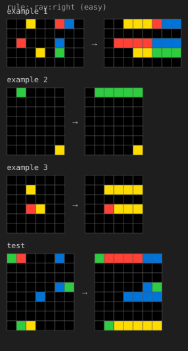
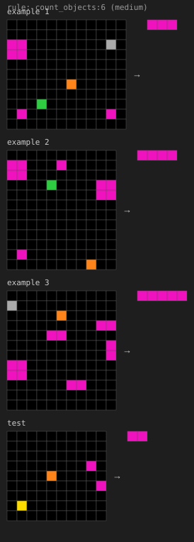
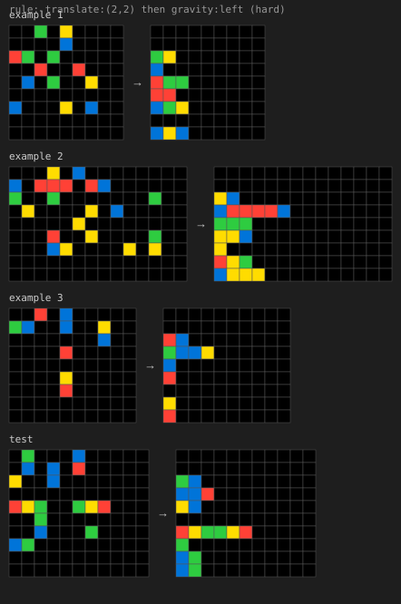

# arc-env

A procedurally generated ARC-AGI style environment for evaluating and training LLMs on
abstract visual reasoning. Unlike the public ARC datasets (fixed, small, and in every
pretraining corpus by now), tasks here are sampled fresh from a library of transformation
families with known solutions, so you get unlimited verifiable episodes and a difficulty knob.

It is an *environment*, not a benchmark: the model gets per-cell feedback and multiple attempts,
and the reward decays with attempts. That makes it directly usable for RL, and it also lets you
measure something a single-shot eval can't: how well a model uses feedback.

## What a task looks like

<p float="left">
  
</p>

The rule is only shown here for illustration; the model never sees it.

```
Example 1 input:          Example 1 output:
0 0 3 0 4 0 0             3 4 0 0 0 0 0
0 0 0 0 1 0 0             1 0 0 0 0 0 0
2 3 0 3 0 0 0             2 3 3 0 0 0 0
...
```

Hidden rule (never shown to the model, logged for analysis): `gravity:left`.

### Transformation families (15)

| family | tier | rule |
|---|---|---|
| flip_rotate | easy | flip H/V, rotate 90/180/270, transpose |
| gravity | easy | all cells fall in one direction and stack |
| recolor_map | easy | fixed color permutation |
| fill_enclosed | easy | fill the inside of hollow shapes with a color |
| ray | easy | every colored cell shoots a line to the edge |
| mirror | easy | output = input glued to its mirror image |
| translate | medium | shift everything by a fixed (dr, dc) |
| swap_most_common | medium | swap the two most frequent colors |
| recolor_by_size | medium | singletons get one color, bigger objects another |
| hollow_out | medium | keep only the border of filled rectangles |
| bounding_box | medium | draw a box around each object |
| denoise | medium | delete isolated pixels |
| crop_largest | medium | output is the bounding box of the largest object |
| tile | medium | tile the input, optionally alternating flips |
| count_objects | medium | count objects of a color, output a 1xN bar |

**Difficulty tiers**: `easy` picks from the six easy families on 5-8 grids. `medium` uses all
15 on 7-12 grids. `hard` uses 9-15 grids and, 70% of the time, *composes two* shape-preserving
primitives (e.g. `translate then gravity`), which gives ~100 distinct rule types.

Every task is checked to be non-trivial (output differs from input, outputs aren't all identical)
and is deterministic from `(seed, difficulty)`.

## Environment API

```python
from arc_env import ArcEnv

env = ArcEnv(difficulty="medium", max_attempts=3)
obs = env.reset(seed=42)        # obs["train"]: list of (input, output); obs["test_input"]
obs, reward, done, info = env.step(my_grid)
# obs["feedback"]: shape_ok, cell_acc, wrong_mask (grid of 1s where you were wrong)
# reward: 1.0 on first-try solve, 0.85 on second, 0.70 on third, else 0
```

## Running the eval

```bash
uv venv && source .venv/bin/activate && uv pip install -e .
source ~/.secrets/anthropic.env           # for Claude models
python -m arc_env.run --models gemma-4-31b,haiku-5.5,sonnet-5.5 --episodes 30
python -m arc_env.run --summary-only      # rebuild results/summary.md from raw jsonl
```

Models: `gemma-4-31b` (any OpenAI-compatible endpoint, default is a local vLLM on :5151),
`haiku-5.5`, `sonnet-5.5`, `opus-5.5`, `sonnet-5.5-think` (Anthropic API). Add more in
`arc_env/clients.py`.

Each episode's full transcript (prompts, model responses, feedback) is saved to
`results/raw/<model>.jsonl` so failures can be read, not just counted.

## Results

30 episodes per tier per model, 3 attempts each, single run (so treat differences under ~10
points as noise). Full tables including per-family breakdown: [results/summary.md](results/summary.md).

| model | easy | medium | hard | expert | first-try (all) | after feedback (all) | cost |
|---|---|---|---|---|---|---|---|
| Claude Opus 5.5 | 100% | 100% | 97% | 77% | 84% | 93% | $5.43 |
| Claude Fable 5.1* | 100% | 100% | 90% | 69% | 84% | 91% | $15.17 |
| Claude Sonnet 5.5 | 100% | 100% | 87% | 60% | 75% | 87% | $3.85 |
| Claude Haiku 5.5 | 100% | 100% | 63% | 27% | 62% | 72% | $0.29 |
| Gemma 4 31B (local vLLM) | 100% | 100% | 50% | 37% | 57% | 72% | $0 |

\* Fable hit the $15 per-model spend cap after 116 episodes, so its expert tier is n=26.

Things I took from this:

- **Easy and medium are saturated** for every model, including a 31B open model. Single-rule
  ARC-style tasks are no longer a test of anything. The signal is entirely in composed rules
  (hard = 2 rules, expert = 3), which is also the direction a curriculum would need to go.
- **Feedback helps the weaker models most.** Per-cell feedback plus two more attempts lifts
  Gemma by 15 points and Haiku by 10, but Fable by only 7. The env's multi-turn design makes
  this measurable; a single-shot benchmark can't see it.
- **The failure modes are legible.** Every single-rule task (easy/medium) was solved by every
  model, so the per-family numbers above 0 failures all come from composed tasks. Reading the
  failed transcripts: the models do not mis-execute a rule they stated correctly, they fail to
  identify the composition at all. Gemma confidently describes a wrong rule; Haiku says outright
  that it "couldn't pin down the rule" and submits a placeholder. Geometric primitives
  (gravity, translate, rotate) are the ones most often lost inside a composition, presumably
  because they move every cell and hide the other rule's signature.
- Cell accuracy on failed expert tasks is 0.6-0.8, so "almost right" is common; a reward with
  partial credit would be dense enough for RL.

## Notes / things I'd do next

- Program-synthesis action mode: have the model emit a Python function instead of a grid and
  score it on held-out pairs. Harder to reward-hack, tests generalization rather than pattern
  completion.
- More families (object counting with comparisons, symmetry repair, path drawing) and 3-primitive
  compositions for an "expert" tier.
- RL training: the env is already reset/step shaped; wire it into a GRPO loop against the Gemma
  server and see whether feedback-driven improvement transfers across families.
